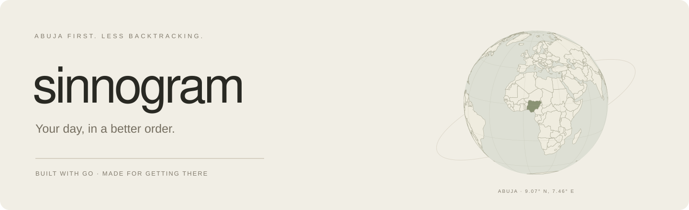
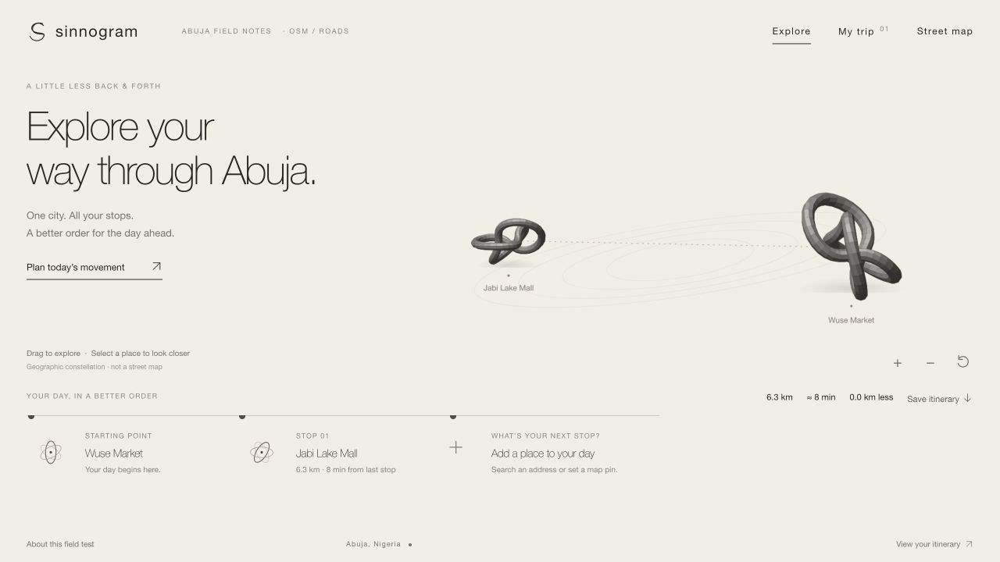

<a href="https://axis-abuja-test.vercel.app"><strong>Try Sinnogram ↗</strong></a> &nbsp; · &nbsp; <a href="docs/SETUP.md">Under the hood</a>

> I just walk around this country and solve my problem, the problems are just fucking too much and yeah im lazy,

So I built this one.

You have six places to be. Somehow, you end up crossing the same part of Abuja four times. Sinnogram takes your stops and puts them in a better order, so your day involves less backtracking and a little more actually getting things done.

**Open beta. No sign-in required. Abuja first.**

### A day, sorted

1. **Start where you are.** Use your location or choose a starting point.
2. **Add everywhere you're going.** Search an address, check its map pin, or place the exact entrance yourself.
3. **Organize the trip.** Compare the whole trip with your original order, then open each leg in Google Maps or Apple Maps.

Come back from Maps and your itinerary is still there. It stays on your device for 24 hours, and you can download a copy or clear it whenever you want.

### The good bits

- Up to **10 stops**, with an optional trip back home.
- **Shortest whole trip** and **nearest next stop** modes. They are different; nearest first can still send you back and forth.
- Real driving distances and time estimates from **OSRM**, using OpenStreetMap data.
- Multiline addresses, street fallbacks, and a real map for confirming the right building.
- A mobile interface with sculptural waypoints, a horizontal trip timeline, and proper SVG icons. No surprise blue emoji buttons.
- A **Go backend**, a small browser frontend, and no frontend build ceremony.
